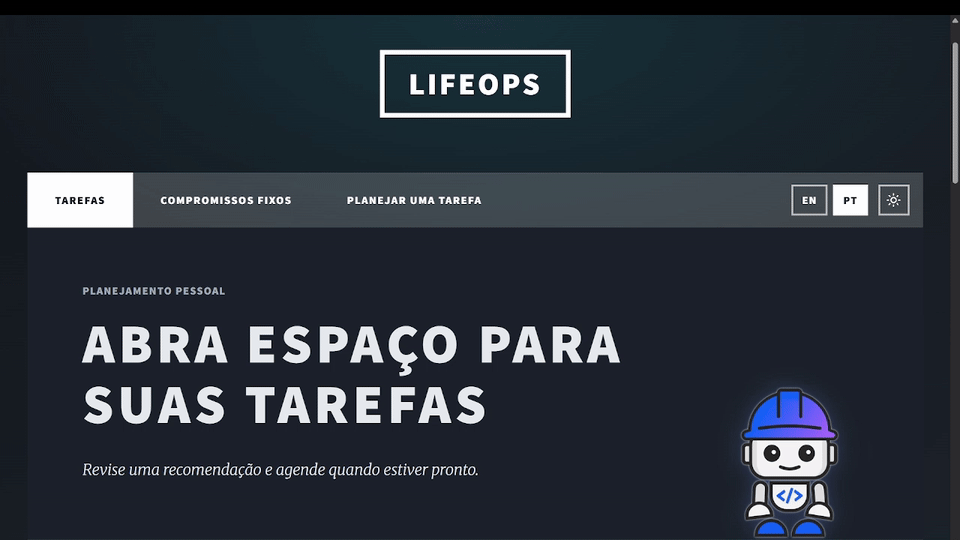
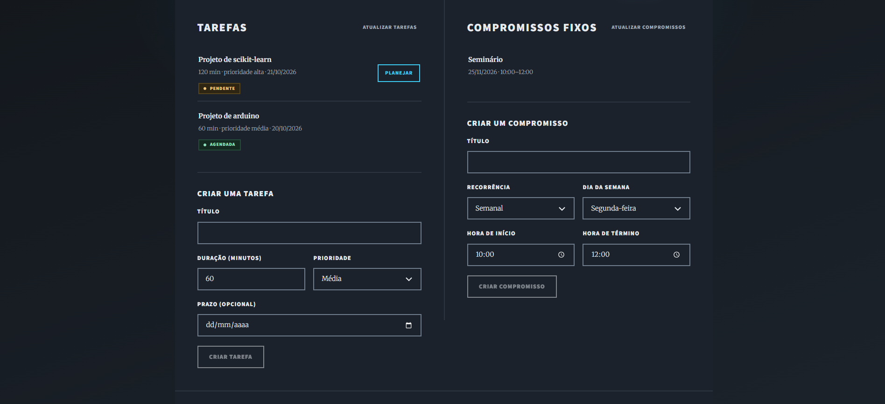
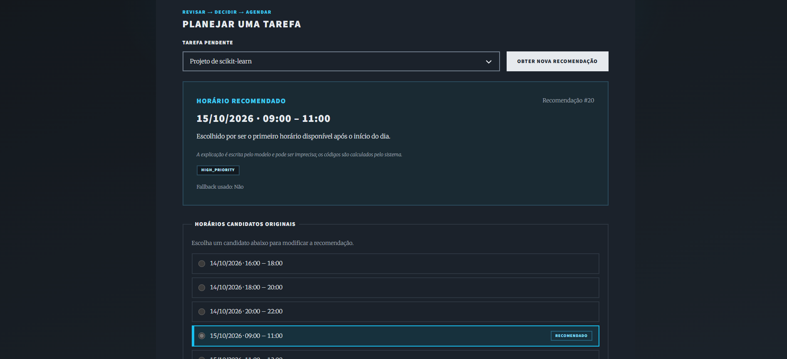
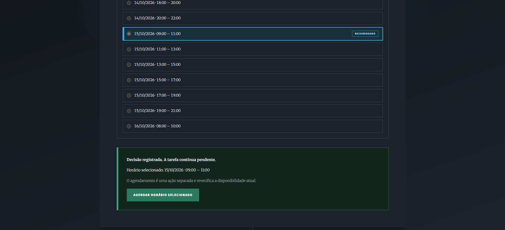

# LifeOps

**Demo online / Live demo: https://boblifeops.vercel.app**

🇧🇷 [Português](#-português) · 🇺🇸 [English](#-english)



| Tarefas e compromissos fixos / Tasks and fixed commitments | Recomendação com explicação / Recommendation with explanation |
|---|---|
|  |  |



---

## 🇧🇷 Português

LifeOps (MVP) organiza tarefas pessoais em volta de compromissos fixos, como faculdade, trabalho, viagens e eventos que viram a noite. Ele resolve a dificuldade de encontrar tempo realista para tarefas com durações, prioridades e prazos diferentes.

> Assistido por IA, controlado por pessoas e auditável por design. Um motor determinístico decide o que é válido, a IA sugere uma opção e a pessoa decide.

As capturas acima mostram a interface em português no tema escuro: a explicação do modelo, o código de motivo calculado pelo sistema, os horários candidatos originais e a decisão registrada, com o passo separado de agendar.

### Stack utilizada

| Camada | Tecnologias |
|---|---|
| Frontend | React 19, TypeScript, Vite, CSS responsivo simples; interface PT/EN e tema claro/escuro; layout adaptado do template Massively (HTML5 UP) |
| Backend | Python 3.12, FastAPI, Pydantic, SQLAlchemy |
| Banco de dados | MySQL 8 (Docker Compose localmente; Azure Database for MySQL na demo) |
| IA | IBM watsonx pelo SDK `ibm-watsonx-ai`, modelo `meta-llama/llama-3-3-70b-instruct` |
| Testes | pytest com testes de integração isolados em SQLite; lint com oxlint no frontend |
| Infraestrutura | Docker e Docker Compose; demo hospedada na Vercel (frontend), Azure App Service (API) e Azure Database for MySQL |

O IBM Bob apoiou o planejamento e a implementação ao longo do ciclo de desenvolvimento, com revisão humana dos planos antes da implementação pelo Agent. Codex e Claude Code também ajudaram na implementação, validação e documentação; nenhuma ferramenta fez todo o trabalho.

### Como funciona

O LifeOps combina um motor determinístico de disponibilidade com uma camada de recomendação por IA. O motor calcula os horários candidatos a partir das restrições, exclui inícios no passado ou no horário atual e aplica a janela diária de trabalho no agendamento. O modelo devolve apenas o ID de um candidato e uma explicação curta; os códigos de motivo são calculados pelo backend. A IA nunca cria disponibilidade nem inventa datas e horários.

```
Compromissos + tarefas + horários existentes + regras
        -> motor determinístico -> horários candidatos válidos
        -> PlannerAgent -> IBM watsonx escolhe um candidate_id
        -> validações do backend + códigos de motivo -> recomendação persistida (auditoria)
        -> decisão humana: APPROVED / MODIFIED / REJECTED (a tarefa continua pendente)
        -> agendamento explícito, revalidado com o estado atual -> horário agendado
```

Recomendar, decidir e agendar são ações separadas. Aprovar uma recomendação deixa a tarefa pendente. O agendamento revalida conflitos e prazos antes de criar o horário. Se o modelo falhar ou responder de forma inválida, o sistema usa o primeiro horário válido e avisa que usou o fallback.

A trilha de auditoria guarda provedor, modelo, candidatos originais, recomendação, explicação, uso de fallback e decisão humana. A resposta bruta do modelo e o raciocínio interno não são armazenados. A explicação em texto livre é escrita pelo modelo e pode ser imprecisa; os códigos de motivo são calculados pelo sistema.

### Rodando localmente

```bash
cp .env.example .env          # preencha os dados do banco; deixe AI_PROVIDER=mock para rodar sem credenciais
docker compose up -d          # MySQL e API em http://localhost:8000
cd frontend && npm install && npm run dev   # http://localhost:5173 (o /api é repassado para a API)
```

Com `AI_PROVIDER=mock`, toda recomendação usa o fallback determinístico. Para recomendações reais, defina `AI_PROVIDER=watsonx` e os valores `WATSONX_*` no `.env`. Rode os testes com `cd backend && python -m pytest`.

### Sobre a demo pública

- Não há login. Cada navegador recebe um identificador aleatório e só vê os próprios dados. Isso separa os dados na demo; **não** é autenticação.
- Os dados de cada visitante são apagados 24 horas depois de criados, e cada visitante pode pedir até 10 recomendações por dia. Há também limites globais de chamadas de IA e de itens por visitante, para proteger a cota gratuita do watsonx.
- A API roda em um plano gratuito do App Service: a primeira requisição depois de um tempo parado pode levar cerca de 20 segundos.
- Datas e horários são valores locais sem fuso, de propósito; não há redesenho de fuso horário.

### Status e validação

O MVP está com o escopo congelado. Suíte do backend: **255 passaram, 1 ignorado** (o ignorado é o teste real do watsonx, que exige credenciais e passou separadamente). Build e lint do frontend passam. O fluxo completo (tarefa, compromissos, recomendação real do watsonx, aprovar/modificar/rejeitar, agendamento explícito, tratamento de conflitos, limite diário) foi exercitado no site público nos dois idiomas, e os dados de teste foram removidos depois.

As chamadas reais ao watsonx foram validadas com o contrato final de dois campos. O modelo usado não é da IBM, mas é servido pelo watsonx, porque o runtime Lite/Sydney não oferecia o IBM Granite; o Granite continua como alvo de validação futura. Números de confiabilidade de amostras pequenas não são garantias.

Limites conhecidos: sem autenticação, um único esquema de banco compartilhado e sem migrações, sem testes automatizados de interação no frontend, datas sem fuso e explicações em texto livre que podem estar erradas.

Próximos passos possíveis além deste MVP: autenticação real, integração com calendário, dados persistentes sem expiração e validação de um modelo IBM Granite.

Veja também o [contexto para agentes](agents.md), o [diário de desenvolvimento](BOB-DEVELOPMENT-LOG.md), o [registro de validação do watsonx](docs/watsonx-validation-plan.md), o [relatório de validação da demo](docs/demo-validation-report.md) e o [relatório de testes](docs/test-report.md). Esses documentos estão em inglês, exceto o relatório de testes.

---

## 🇺🇸 English

LifeOps (MVP) helps organize personal tasks around fixed commitments such as university, work, travel, and overnight events. It addresses the difficulty of finding realistic time for tasks with different durations, priorities, and deadlines.

> AI-assisted, human-controlled and auditable by design. A deterministic engine decides what is valid, an AI suggests one option, and the person decides.

The captures above show the Portuguese interface in the dark theme: the model's explanation, the system-computed reason code, the original candidates, and the recorded decision with the separate "book" step.

### Stack

| Layer | Technologies |
|---|---|
| Frontend | React 19, TypeScript, Vite, plain responsive CSS; EN/PT interface and light/dark theme; layout adapted from the Massively template by HTML5 UP |
| Backend | Python 3.12, FastAPI, Pydantic, SQLAlchemy |
| Database | MySQL 8 (Docker Compose locally; Azure Database for MySQL in the demo) |
| AI | IBM watsonx through the `ibm-watsonx-ai` SDK, model `meta-llama/llama-3-3-70b-instruct` |
| Tests | pytest with isolated SQLite integration tests; oxlint for the frontend |
| Infrastructure | Docker and Docker Compose; demo hosted on Vercel (frontend), Azure App Service (API) and Azure Database for MySQL |

IBM Bob supported planning and implementation across the software development lifecycle, with human review of plans before Agent implementation. Codex and Claude Code also assisted with implementation, validation and documentation; no single tool did all of the work.

### How it works

LifeOps combines a deterministic availability engine with an AI recommendation layer. The engine computes candidate slots from scheduling constraints, excludes starts at or before the current time, and enforces the configured daily work window when booking. The model returns only a candidate ID and a concise explanation; the backend derives reason codes deterministically. AI never creates availability or invents scheduling datetimes.

```
Commitments + tasks + existing slots + rules
        -> deterministic availability engine -> valid candidate slots
        -> PlannerAgent -> IBM watsonx picks a candidate_id
        -> backend guards + derived reason codes -> persisted recommendation (audit)
        -> human decision: APPROVED / MODIFIED / REJECTED (task stays pending)
        -> explicit booking, revalidated against current state -> scheduled slot
```

Recommendations, human decisions, and booking are separate actions. Approving a recommendation leaves the task pending. An explicit booking request revalidates current conflicts and deadlines before creating a scheduled slot. If the model fails or answers invalidly, the system falls back to the first valid slot and says so.

The audit trail records the provider, model, original candidates, recommendation, explanation, fallback status, and human decision. Raw model output and hidden chain-of-thought are not stored. The free-text explanation is written by the model and can be imprecise; the reason codes are computed by the system.

### Run locally

```bash
cp .env.example .env          # fill the database values; leave AI_PROVIDER=mock to run without credentials
docker compose up -d          # MySQL and the API on http://localhost:8000
cd frontend && npm install && npm run dev   # http://localhost:5173 (proxies /api to the API)
```

With `AI_PROVIDER=mock` every recommendation uses the deterministic fallback. Set `AI_PROVIDER=watsonx` and the `WATSONX_*` values in `.env` for real recommendations. Run the tests with `cd backend && python -m pytest`.

### About the public demo

- There is no login. Each browser gets a random identifier and only sees its own data. This separates data for a demo; it is **not** authentication.
- A visitor's data is deleted 24 hours after it is created, and each visitor can request up to 10 recommendations per day. There are also global limits on AI calls and on items per visitor to protect the free watsonx quota.
- The API runs on a free App Service plan: the first request after a period of inactivity can take about 20 seconds.
- Dates and times are naive local values on purpose; there is no time-zone redesign.

### Status and validation

The MVP is feature-frozen. Backend suite: **255 passed, 1 skipped** (the skip is the live watsonx smoke test, which needs credentials and passed separately). Frontend build and lint pass. The full flow (task, commitments, real watsonx recommendation, approve/modify/reject, explicit booking, conflict handling, daily limit) was exercised on the public site in both languages, with all test data removed afterwards.

Real watsonx calls were validated with the final two-field contract. The model used is a non-IBM model served through IBM watsonx, because the Lite/Sydney runtime did not offer IBM Granite; Granite remains a future validation target. Reliability figures from small samples are not guarantees.

Known limits: no authentication, a single shared database schema without migrations, no automated frontend interaction tests, naive datetimes, and free-text explanations that may be wrong.

Possible next steps beyond this MVP: real authentication, calendar integration, persistent data without expiry, and validating an IBM Granite model.

See [agent context](agents.md), [development log](BOB-DEVELOPMENT-LOG.md), [watsonx validation record](docs/watsonx-validation-plan.md), [demo validation report](docs/demo-validation-report.md) and [test report](docs/test-report.md) for details.
